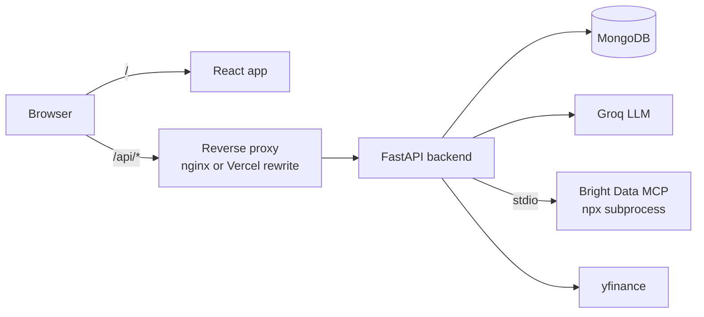

# TradeDesk

A full-stack trading journal for the Indian stock market (NSE) with a team of AI research agents.
Log your trades, see real profit and loss for every stock, and ask four cooperating agents to find, check and
price a short-term idea using live web search.


<!-- Add screenshots here once you have them:


-->

> **Disclaimer:** TradeDesk is a learning project. AI-generated recommendations can be wrong or out of date and are
> not investment advice. Always verify prices and news yourself before trading.

## Features

- **Secure accounts:** register and sign in with JWT access tokens and rotating refresh tokens. "Keep me signed in"
  keeps you logged in for 30 days.
- **Trader profile dashboard:** holdings, average cost, live prices, booked and unrealised P&L, win rate on sells,
  allocation chart, P&L by stock, and full trade history.
- **AI stock picks:** a LangGraph supervisor coordinates four agents (stock finder, market data, news analyst,
  price recommender) that use the Bright Data MCP server for web search and scraping.
- **Light and dark themes**, responsive layout.
- **Containerised:** one `docker compose up` runs the database, API and frontend.

## Tech stack

| Layer | Technology |
|---|---|
| Frontend | React 18, Vite, React Router, Recharts, Axios |
| Backend | FastAPI, Motor (async MongoDB driver), PyJWT, bcrypt |
| Database | MongoDB (Atlas or a local container) |
| AI agents | LangChain, LangGraph supervisor, Groq LLMs, Bright Data MCP |
| Market data | yfinance (NSE tickers as `SYMBOL.NS`) |
| Packaging | Docker, Docker Compose, nginx |
| Hosting | Render (backend), Vercel (frontend), MongoDB Atlas |

## Architecture



The browser only ever talks to one origin. A proxy forwards `/api/*` to the backend, so the httpOnly refresh cookie
stays first-party and no CORS setup is needed in production.

### The AI pipeline

A supervisor delegates to four agents, one at a time:

1. **Stock finder:** searches the web for NSE stocks currently in the news with strong volume or momentum.
2. **Market data:** gets last close, 1/5/21-day change, volume ratio, RSI, 50 and 200-day averages and the 52-week
   range (from yfinance, or from the web with `MARKET_DATA_SOURCE=web`).
3. **News analyst:** summarises and classifies the latest news per stock.
4. **Price recommender:** gives an action, entry, target and stop-loss using only the data it was handed.

The backend checks that all four agents reported and sends the supervisor back if one was skipped. Agents know the
current India time and whether the NSE is open, so advice outside market hours is framed for the next session.
Runs execute in the background and the UI polls for the result.

## Project structure

```
tradedesk/
├── backend/
│   ├── app/
│   │   ├── main.py            # FastAPI app, CORS, router wiring
│   │   ├── config.py          # settings from environment variables
│   │   ├── db.py              # Mongo client and indexes
│   │   ├── security.py        # password hashing, JWT, refresh tokens
│   │   ├── deps.py            # current-user dependency
│   │   ├── quotes.py          # cached live prices
│   │   ├── routers/
│   │   │   ├── auth.py        # register, login, refresh, logout, me
│   │   │   ├── portfolio.py   # trades and portfolio summary
│   │   │   └── agent.py       # start and read AI runs
│   │   └── agent/
│   │       ├── stock_agent.py   # supervisor and four agents
│   │       └── market_tools.py  # indicator calculations (yfinance)
│   ├── Dockerfile
│   ├── requirements.txt
│   └── .env.example
├── frontend/
│   ├── src/                   # pages, components, auth, API client, styles
│   ├── Dockerfile             # multi-stage: build with Node, serve with nginx
│   ├── nginx.conf.template    # serves the app and proxies /api to the backend
│   ├── vercel.json            # rewrites used on Vercel
│   └── package.json
├── docker-compose.yml         # mongo + backend + frontend
└── README.md
```

## Quick start

You need API keys for [Groq](https://console.groq.com) and [Bright Data](https://brightdata.com) to use the AI
picks page. The rest of the app works without them.

### Option A: Docker Compose (recommended)

Requires Docker Desktop.

```bash
cp backend/.env.example backend/.env      # then edit it (see Configuration)
docker compose up -d --build
```

Open http://localhost:3000. API docs are at http://localhost:8000/docs.
Compose starts its own MongoDB container, so `MONGO_URL` in your `.env` is overridden automatically.

Useful commands:

```bash
docker compose ps                  # status and health
docker compose logs -f backend     # follow backend logs
docker compose down                # stop (data is kept in a volume)
docker compose down -v             # stop and delete the database volume
```

### Option B: run each part locally

Requires Python 3.10+, Node.js 18+ (the agent launches `npx @brightdata/mcp`) and a MongoDB, for example a free
MongoDB Atlas cluster.

```bash
# backend
cd backend
python3 -m venv .venv && source .venv/bin/activate
python -m pip install -r requirements.txt
cp .env.example .env                       # fill in the values
python -m uvicorn app.main:app --reload --port 8000

# frontend (second terminal)
cd frontend
npm install
npm run dev                                # http://localhost:5173, /api is proxied to :8000
```

## Configuration

All backend settings are environment variables (`backend/.env` locally, the hosting dashboard in production).
Never commit `.env`.

| Variable | Purpose | Default |
|---|---|---|
| `MONGO_URL` | MongoDB connection string | `mongodb://localhost:27017` |
| `MONGO_DB` | Database name | `tradedesk` |
| `JWT_SECRET` | Signs access tokens. Use a long random value | none, required |
| `ACCESS_MINUTES` | Access token lifetime | `15` |
| `REFRESH_DAYS_SESSION` | Refresh token lifetime without "keep me signed in" | `1` |
| `REFRESH_DAYS_REMEMBER` | Lifetime with "keep me signed in" | `30` |
| `COOKIE_SECURE` | Send the refresh cookie over HTTPS only. `true` in production | `false` |
| `CORS_ORIGINS` | Allowed browser origins, comma separated | `http://localhost:5173` |
| `GROQ_API_KEY` | Groq API key | none, required for AI picks |
| `GROQ_MODEL` | Model id, for example `openai/gpt-oss-120b`. Pick one your account can use | `llama-3.3-70b-versatile` |
| `GROQ_MAX_TOKENS` | Cap on tokens per model reply (helps stay under free-tier limits) | `2000` |
| `BRIGHT_DATA_API_TOKEN` | Bright Data API token | none, required for AI picks |
| `WEB_UNLOCKER_ZONE`, `BROWSER_ZONE` | Bright Data zone names | `unblocker`, `scraping_browser` |
| `BRIGHT_DATA_TOOLS` | Which MCP tools the agents may use | `search_engine,scrape_as_markdown` |
| `TOOL_OUTPUT_MAX_CHARS` | Truncates tool output to save tokens | `2000` |
| `MARKET_DATA_SOURCE` | `yfinance` (exact numbers) or `web` (Bright Data) | `yfinance` |

Generate a secret with:

```bash
python3 -c "import secrets; print(secrets.token_urlsafe(64))"
```

## API overview

Interactive docs are served at `/docs`.

| Method and path | Description |
|---|---|
| `POST /api/auth/register`, `POST /api/auth/login` | Create an account or sign in |
| `POST /api/auth/refresh`, `POST /api/auth/logout` | Rotate the session or end it |
| `GET /api/auth/me` | Current user |
| `GET /api/trades`, `POST /api/trades` | List or log trades |
| `DELETE /api/trades/{id}` | Delete a trade |
| `GET /api/portfolio/summary` | Holdings, totals, P&L and win rate |
| `POST /api/agent/runs` | Start an AI analysis (runs in the background) |
| `GET /api/agent/runs`, `GET /api/agent/runs/{id}` | List runs or read one |
| `GET /api/health` | Health check |

## How authentication works

- Login returns a short-lived access JWT, which the React app keeps in memory only.
- A random refresh token is stored as an httpOnly cookie (path `/api/auth`). Only its SHA-256 hash is stored in MongoDB.
- With "keep me signed in", the cookie and its database record last 30 days. Otherwise it is a session cookie that
  expires within a day.
- On page load the app calls `/api/auth/refresh` to restore the session. Every refresh rotates the token.
- When an API call returns 401, the Axios interceptor refreshes once and retries the request.
- Passwords are hashed with bcrypt.

## How profit and loss is calculated

Positions use the **average cost** method. Buying raises the quantity and cost basis (fees included). Selling realises
profit or loss against the current average cost. Unrealised P&L compares the current price with the cost basis of
the shares you still hold. Live prices come from Yahoo Finance via yfinance and are cached for 60 seconds. If a quote
is unavailable, the dashboard falls back to your average cost and marks it as an estimate.

## Deployment

The backend runs on Render (Docker), the frontend on Vercel, and the database on MongoDB Atlas.

1. **Atlas:** allow network access from `0.0.0.0/0` (Render's free instances have no fixed IP) and use a strong
   database password.
2. **Render:** create a Web Service from this repo with language **Docker** and root directory `backend`. Set the
   environment variables from the table above (use a new `JWT_SECRET` and `COOKIE_SECURE=true`) and set the health
   check path to `/api/health`. Render supplies `PORT`, which the Dockerfile reads.
3. **Vercel:** import the repo with root directory `frontend`. Add `frontend/vercel.json` with your Render URL:

   ```json
   {
     "$schema": "https://openapi.vercel.sh/vercel.json",
     "rewrites": [
       { "source": "/api/:path*", "destination": "https://YOUR-SERVICE.onrender.com/api/:path*" },
       { "source": "/((?!api/).*)", "destination": "/index.html" }
     ]
   }
   ```

Free-tier notes: Render's free web services sleep after about 15 minutes of inactivity and take up to a minute to wake,
have limited memory, and may restart at any time (an AI run in progress is then marked failed). Check each
provider's current limits before relying on them.

## Known limitations

- AI output is only as good as the web pages and data it finds. Verify before acting.
- NSE exchange holidays are not tracked, so the "market open" check only considers weekdays and trading hours.
- Yahoo Finance is an unofficial data source and may lag, fail or rate-limit cloud hosts.
- Groq's free tier limits tokens per minute, so some runs may pause, retry or fail. Lower `TOOL_OUTPUT_MAX_CHARS`
  or choose another model if that happens.
- AI runs execute inside the API process. For multiple instances, move them to a worker queue (Celery, RQ or arq).

## Roadmap

- Stream each agent's progress live instead of polling
- Structured picks with an "add to portfolio" button
- Portfolio value over time
- Automated tests and a CI pipeline (GitHub Actions)
- Worker queue for agent runs

## License

Add a `LICENSE` file (for example MIT) before making the repository public.
